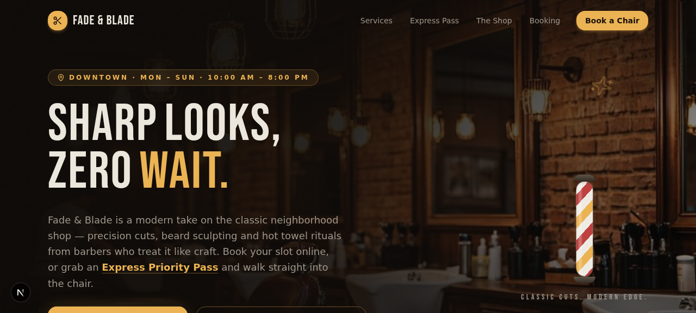
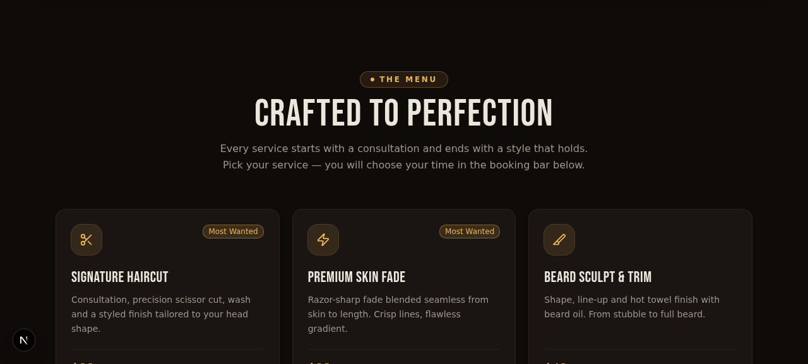
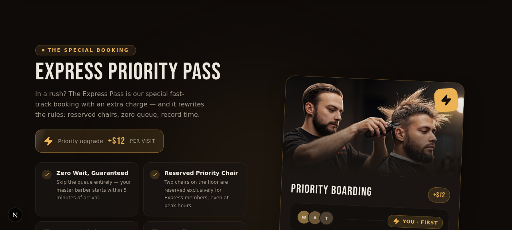
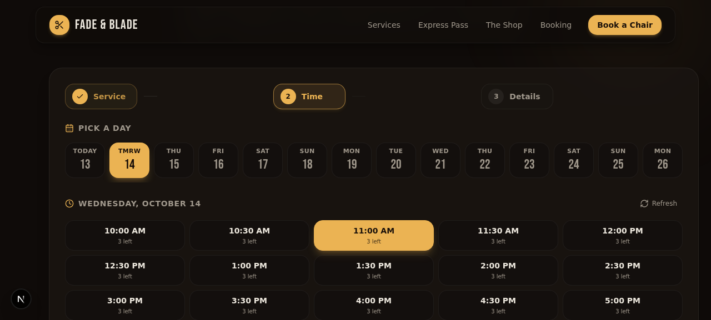
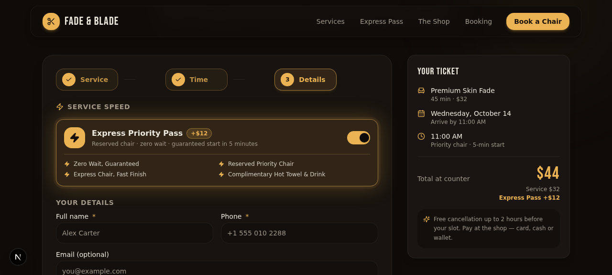
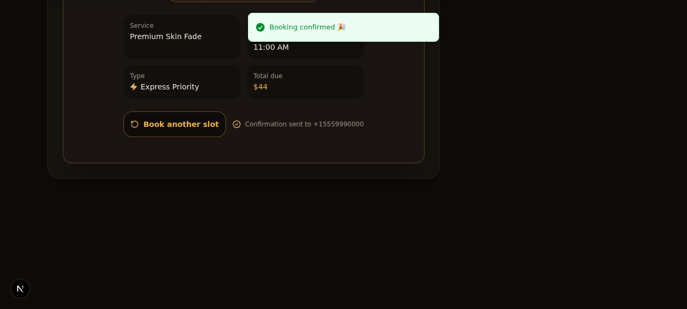
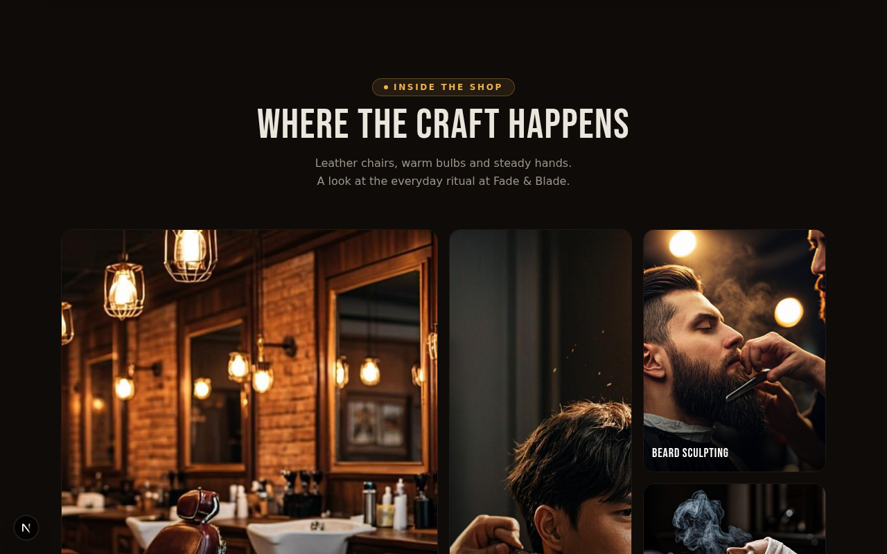
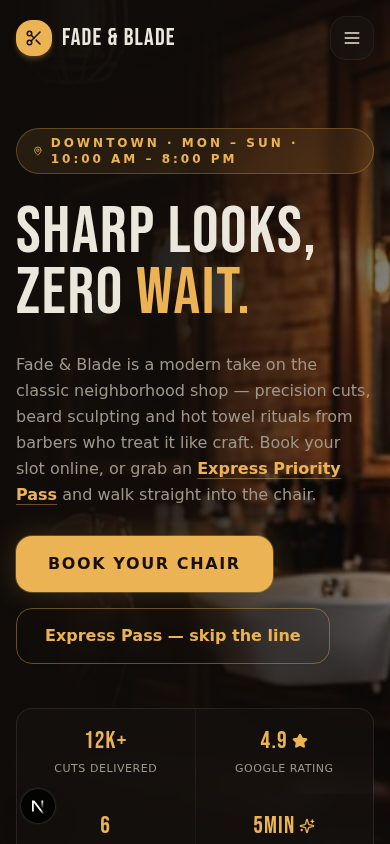

<div align="center">

# ✂️ FADE & BLADE

### *Sharp Looks. Zero Wait.*

**A premium barbershop booking experience with real-time time-slot scheduling, cinematic animations, and an Express Priority Pass — the special paid booking that lets customers skip the queue entirely.**

<br>


<br>



<br>

**[🎬 Jump to the Feature Walkthrough](#-live-demo--feature-walkthrough) · [⚡ Express Pass](#-the-special-booking--express-priority-pass) · [🔌 API](#-api-reference) · [🚀 Deploy](#%EF%B8%8F-deployment)**

</div>

---

## 📋 Table of Contents

- [About The Project](#-about-the-project)
- [🎬 Live Demo — Feature Walkthrough](#-live-demo--feature-walkthrough)
  - [1. Animated Hero & CSS Barber Pole](#1-animated-hero--css-barber-pole)
  - [2. Infinite Marquee Ribbon](#2-infinite-marquee-ribbon)
  - [3. Services Menu — Hover-Tilt Cards](#3-services-menu--hover-tilt-cards)
  - [4. 💎 The Special Booking — Express Priority Pass](#4--the-special-booking--express-priority-pass)
  - [5. Step 1 — Pick Your Service](#5-step-1--pick-your-service)
  - [6. Step 2 — Pick Your Date & Time Slot](#6-step-2--pick-your-date--time-slot)
  - [7. Step 3 — Express Toggle, Live Ticket & Details](#7-step-3--express-toggle-live-ticket--details)
  - [8. Confirmation — Confetti & Booking Code](#8-confirmation--confetti--booking-code)
  - [9. The Shop Gallery](#9-the-shop-gallery)
  - [10. Mobile-First & Butter-Smooth](#10-mobile-first--butter-smooth)
- [🧠 The Booking Engine — How It Works](#-the-booking-engine--how-it-works)
- [🧱 Tech Stack](#-tech-stack)
- [📁 Project Structure](#-project-structure)
- [🔌 API Reference](#-api-reference)
- [🚀 Getting Started](#-getting-started)
- [⚙️ Tuning The Shop](#%EF%B8%8F-tuning-the-shop)
- [☁️ Deployment](#%EF%B8%8F-deployment)
- [🗺️ Roadmap](#%EF%B8%8F-roadmap)
- [🤝 Contributing & License](#-contributing--license)

---

## 🧔 About The Project

**Fade & Blade** is a full booking experience for a modern barbershop — not just a landing page with a phone number. Customers browse the service menu, pick a day and an exact 30-minute time slot, watch the available chairs update in real time, and lock in their appointment with a unique `FB-XXXXXX` confirmation code.

The signature feature is the **Express Priority Pass** — a special booking tier with an **extra charge (+$12)** that buys a guaranteed zero-wait experience: reserved chairs that standard bookings can never touch, a 5-minute guaranteed start, and a hot-towel finish on the house. Even when every standard chair is sold out, Express seats stay open — and the UI actively offers the upgrade when a slot is full.

Every pixel was designed to feel like the shop itself: espresso-dark interiors, amber-gold light, a spinning barber pole, and motion everywhere — staggered text reveals, tilt-on-hover cards, animated totals, and a confetti burst on confirmation.

<div align="right"><a href="#-table-of-contents">⬆ back to top</a></div>

---

## 🎬 Live Demo — Feature Walkthrough

> Every feature below is captured from the running app. Follow along top-to-bottom and you have seen the entire customer journey.

### 1. Animated Hero & CSS Barber Pole


The first thing you see is a full-viewport hero over a warm shop interior. The headline **"SHARP LOOKS, ZERO WAIT."** enters with a *staggered Bebas Neue reveal* — each line slides up with a spring easing curve a beat after the previous one. On the right sits a **pure-CSS barber pole** (`barber-pole.tsx`) whose red/white/amber stripes scroll endlessly via a `pole-spin` keyframe — no GIF, no video, just gradients and `@keyframes`.

What is happening under the hood:

- **Scroll-aware navbar** — hides as you scroll down, reappears with a backdrop blur the moment you scroll up (Framer Motion `useScroll`).
- **Floating micro-details** — a soft `floaty` keyframe animates the sparkle icon; a `glow-pulse` keyframe breathes life into the amber accents.
- **Trust strip** — live stats (`12K+ cuts delivered`, `4.9★ rating`, `5 min express start`) anchor the two CTAs: *Book Your Chair* (smooth-scrolls to the booking flow) and *Express Pass — skip the line* (pre-selects the express upgrade via the Zustand store).

<div align="right"><a href="#-table-of-contents">⬆ back to top</a></div>

### 2. Infinite Marquee Ribbon

Directly under the hero, an infinitely scrolling ribbon loops the shop's promises — `WALK-INS WELCOME ✦ HOT TOWEL FINISH ✦ 5-MIN EXPRESS START ✦ MASTER BARBERS ✦` — powered by a GPU-friendly `marquee-x` transform keyframe that never pauses the main thread.

<div align="right"><a href="#-table-of-contents">⬆ back to top</a></div>

### 3. Services Menu — Hover-Tilt Cards



Six services are seeded into SQLite and served from `GET /api/services`. Each card features:

- **3D hover tilt** — the card rotates toward your cursor with a spring physics transition (Framer Motion), plus an amber border glow.
- **"Most Wanted" badges** for popular services, icon chips, duration & price rows.
- **One-click booking** — the "Book this" shortcut pre-fills the service in the booking flow and scrolls you straight to Step 1.

| Service | Price | Duration |
| --- | --- | --- |
| Signature Haircut | $28 | 45 min |
| Premium Skin Fade | $32 | 45 min |
| Beard Sculpt & Trim | $18 | 30 min |
| Royal Hot Towel Shave | $30 | 40 min |
| Cut + Beard Combo | $42 | 60 min |
| Kids Cut (u12) | $16 | 30 min |

<div align="right"><a href="#-table-of-contents">⬆ back to top</a></div>

### 4. 💎 The Special Booking — Express Priority Pass



**This is the special paid booking the shop is built around.** For a flat **+$12 per visit**, the Express Pass rewrites the rules of the queue:

| | 🪑 Standard Booking | ⚡ Express Priority Pass (+$12) |
| --- | --- | --- |
| **Chairs** | 3 shared chairs per slot | 2 chairs **reserved for Express only** |
| **Wait time** | First free slot | **Guaranteed start within 5 minutes** |
| **Availability** | Blocked when the 3 standard chairs are full | **Still bookable when standard is sold out** |
| **Perks** | — | Hot towel finish + complimentary drink |

The section presents this with an animated **"Priority Boarding" card** — a visual queue that shows standard customers waiting (`W A T…`) while the Express badge flashes **YOU · FIRST**. Benefits roll in with staggered scroll-reveal animations (`reveal.tsx` uses `useInView` so animations fire exactly when the section enters the viewport).

> 🔎 **Why it matters:** the express inventory is enforced server-side. `POST /api/bookings` counts express bookings per slot against `EXPRESS_CHAIRS_PER_SLOT = 2`, so standard traffic can never steal a priority chair — and when a standard slot fills up, the API returns a `SLOT_FULL_TRY_EXPRESS` hint that the UI turns into a one-tap upgrade toast.

<div align="right"><a href="#-table-of-contents">⬆ back to top</a></div>

### 5. Step 1 — Pick Your Service

The booking panel is a **3-step wizard** (`booking.tsx`) with animated step pills. Step 1 lists the live services from the database with prices and durations. Selecting a card animates the panel forward (Framer Motion `AnimatePresence` slide + fade) to the time picker. The step tracker at the top fills with amber as you progress — completed steps get a check, the active step glows.

<div align="right"><a href="#-table-of-contents">⬆ back to top</a></div>

### 6. Step 2 — Pick Your Date & Time Slot



The heart of the time-slot system:

- **14-day date rail** — horizontally scrollable day chips (`TODAY 13`, `TMRW 14`, …), generated client-side, validated server-side.
- **Live capacity per slot** — every 30-minute slot from **10:00 AM to 7:00 PM** queries `GET /api/availability?date=YYYY-MM-DD` and renders remaining chairs ("3 left") under each time.
- **Smart slot states** — past slots are disabled; fully-booked slots dim with a "Full" tag; slots with zero standard chairs but free express seats show an amber **⚡ Express-only** state that invites the upgrade.
- **Refresh button** re-syncs availability without losing your selection.

<div align="right"><a href="#-table-of-contents">⬆ back to top</a></div>

### 7. Step 3 — Express Toggle, Live Ticket & Details



The details step is where the special booking comes alive:

- **Express Priority Pass toggle** — one flip and the whole panel changes mood: the pass card lights up amber, benefits list reload in, and the ticket on the right recalculates **$32 → $44** with an animated number roll. The line item breaks the price down: `Service $32 + Express Pass +$12`.
- **Your Ticket** — a live summary card (service, duration, date, arrival time, priority status) that updates instantly with every change, like a boarding pass being printed.
- **Validated form** — name, phone (min 7 chars), optional email & notes, all validated client-side with react-hook-form + zod and re-validated server-side on submit.
- **Free-cancellation hint** — "up to 2 hours before your slot. Pay at the shop — card, cash or wallet."

<div align="right"><a href="#-table-of-contents">⬆ back to top</a></div>

### 8. Confirmation — Confetti & Booking Code



On success the server returns the created booking with a unique human-friendly code (`FB-` + 6 characters from a confusion-safe alphabet — no `O/0`, no `I/1`). The screen celebrates with:

- An **SVG checkmark that draws itself** (stroke-dashoffset animation) inside a pulsing ring,
- A **confetti burst** rendered by the booking success component,
- A toast: *"Booking confirmed 🎉"* — plus a **"Book another slot"** action that resets the wizard while keeping your contact details.

Every booking is retrievable anytime via `GET /api/bookings?code=FB-XXXXXX`.

<div align="right"><a href="#-table-of-contents">⬆ back to top</a></div>

### 9. The Shop Gallery



An asymmetric masonry grid of the shop — leather chairs, warm bulbs, hot-towel smoke. Images zoom subtly on hover behind a gradient caption ("BEARD SCULPTING", "THE FLOOR") and reveal on scroll with the shared `reveal.tsx` wrapper.

<div align="right"><a href="#-table-of-contents">⬆ back to top</a></div>

### 10. Mobile-First & Butter-Smooth



The entire experience is responsive: the navbar collapses into an animated hamburger sheet, the date rail swipes, the ticket stacks below the form, touch targets stay ≥ 44px, and the footer always sticks to the bottom of the viewport — never floats, never overlaps.

<div align="right"><a href="#-table-of-contents">⬆ back to top</a></div>

---

## 🧠 The Booking Engine — How It Works

All business rules live in **one file** (`src/lib/constants.ts`) and are enforced **server-side** in the API layer, so the client can be trusted for UX but never for inventory.

```text
Opening hours        10:00 AM – 8:00 PM (Mon–Sun)
Slot length          30 minutes (last booking starts 7:00 PM)
Booking window       next 14 days, including today
Standard capacity    3 chairs per slot   → enforced by POST /api/bookings
Express capacity     2 chairs per slot   → never shared with standard
Express fee          flat $12, added to the service price
Confirmation code    FB-XXXXXX, confusion-safe alphabet (no O/0, I/1)
Double-booking       blocked per (date, timeSlot, chair-pool) with HTTP 409
```

**Slot decision logic** (server-side, `POST /api/bookings`):

```text
Requested express?
├── YES → count express bookings in slot
│         ├── < 2  → ✅ confirm  (price = service + $12)
│         └── ≥ 2  → ❌ 409 "Express seats fully reserved"
└── NO  → count standard bookings in slot
          ├── < 3  → ✅ confirm  (price = service)
          └── ≥ 3  → ❌ 409 SLOT_FULL_TRY_EXPRESS
                     → UI offers a one-tap Express upgrade ⚡
```

A booking is stored with its price breakdown (`expressFee`, `totalPrice`) so receipts and audits stay consistent.

<div align="right"><a href="#-table-of-contents">⬆ back to top</a></div>

---

## 🧱 Tech Stack

| Layer | Technology | Why |
| --- | --- | --- |
| Framework | **Next.js 16 (App Router)** + React 19 | Server components, route handlers, image optimization |
| Language | **TypeScript 5** (strict) | End-to-end type safety from schema to UI |
| Styling | **Tailwind CSS 4** + CSS custom properties | Dark espresso/amber theme as design tokens |
| UI Kit | **shadcn/ui** (Radix primitives) | Accessible dialogs, toasts, forms out of the box |
| Animation | **Framer Motion 12** + custom `@keyframes` | Springs, staggering, scroll reveals, AnimatePresence step transitions |
| State | **Zustand** | Cross-component pre-selection (service / express shortcuts) |
| Forms | **react-hook-form + zod** | Client & server validation from one schema style |
| Database | **Prisma ORM + SQLite** | Zero-config persistence, perfect for a single shop |
| Icons | **Lucide** | Crisp, consistent iconography |
| Toasts | **Sonner** | Confirmation & upgrade hints |

<div align="right"><a href="#-table-of-contents">⬆ back to top</a></div>

---

## 📁 Project Structure

```text
BARBER-SSSS/
├── prisma/
│   └── schema.prisma          # Service & Booking models (SQLite)
├── db/                        # SQLite database file (generated)
├── public/
│   ├── images/                # Hero, gallery & express imagery
│   └── logo.svg
├── docs/
│   └── screenshots/           # Captures used in this README
├── src/
│   ├── app/
│   │   ├── page.tsx           # Single-page composition of all sections
│   │   ├── layout.tsx         # Fonts (Bebas Neue / Geist), metadata, Toaster
│   │   ├── globals.css        # Theme tokens + marquee / pole / shimmer keyframes
│   │   └── api/
│   │       ├── services/route.ts       # GET  — catalogue (auto-seeds on first hit)
│   │       ├── availability/route.ts   # GET  — per-slot remaining chairs
│   │       └── bookings/route.ts       # POST — create · GET ?code= — lookup
│   ├── components/
│   │   ├── barber/            # ✂️ The whole experience
│   │   │   ├── navbar.tsx         # Scroll-aware, blur, mobile sheet
│   │   │   ├── hero.tsx           # Staggered reveal, stats, CTAs
│   │   │   ├── barber-pole.tsx    # Pure-CSS spinning pole
│   │   │   ├── marquee.tsx        # Infinite ribbon
│   │   │   ├── services.tsx       # Hover-tilt service cards
│   │   │   ├── express.tsx        # Priority Boarding card + benefits
│   │   │   ├── booking.tsx        # 3-step wizard orchestrator
│   │   │   ├── booking-parts.tsx  # Date rail, slot grid, ticket, success view
│   │   │   ├── reveal.tsx         # Shared scroll-reveal wrapper
│   │   │   ├── gallery.tsx        # Masonry gallery
│   │   │   └── footer.tsx         # Sticky footer
│   │   └── ui/                # shadcn/ui primitives
│   ├── hooks/                 # use-toast, use-mobile
│   └── lib/
│       ├── constants.ts       # 🎛️ ALL business rules in one place
│       ├── slots.ts           # Slot generation, past-slot & date-window guards
│       ├── booking-store.ts   # Zustand — express/service pre-selection
│       ├── seed.ts            # Idempotent service catalogue seeding
│       ├── db.ts              # Prisma singleton
│       └── types.ts           # Shared DTOs (ServiceDto, SlotInfo, …)
├── .env.example               # Environment template
└── package.json
```

<div align="right"><a href="#-table-of-contents">⬆ back to top</a></div>

---

## 🔌 API Reference

Base URL: `/api`

### `GET /api/services`

Returns the active service catalogue. **Auto-seeds the six services on first request** if the table is empty.

```jsonc
// 200 OK
{
  "services": [
    { "id": "clx…", "slug": "skin-fade", "name": "Premium Skin Fade",
      "description": "Razor-sharp fade…", "price": 32, "duration": 45,
      "icon": "zap", "popular": true }
  ]
}
```

### `GET /api/availability?date=YYYY-MM-DD`

Returns every slot of the day with remaining capacity for both pools.

```jsonc
// 200 OK
{
  "date": "2026-10-14",
  "slots": [
    { "slot": "10:00", "label": "10:00 AM",
      "regularLeft": 2, "expressLeft": 2,
      "regularAvailable": true, "expressAvailable": true },
    { "slot": "11:00", "label": "11:00 AM",
      "regularLeft": 0, "expressLeft": 1,
      "regularAvailable": false, "expressAvailable": true }  // ⚡ express-only
  ]
}
```

### `POST /api/bookings`

Creates a booking. Validates the date window, opening hours, past slots, service existence and **per-slot chair capacity** — with a special `SLOT_FULL_TRY_EXPRESS` hint when standard is full but express is not.

```jsonc
// Request
{
  "serviceId": "clx…",
  "date": "2026-10-14",
  "timeSlot": "11:00",
  "isExpress": true,            // ⚡ the special booking — adds $12
  "customerName": "Alex Carter",
  "phone": "+1 555 010 2288",
  "email": "alex@example.com",  // optional
  "notes": "Skin fade, tight lineup"  // optional
}

// 201 Created
{
  "booking": {
    "code": "FB-T2MRGN",
    "isExpress": true,
    "expressFee": 12,
    "totalPrice": 44,
    "status": "CONFIRMED",
    "service": { "name": "Premium Skin Fade", "duration": 45, "price": 32 }
  }
}

// 409 Conflict (standard full, express open)
{ "error": "Standard chairs are fully booked for this slot. Express seats may still be open — upgrade for $12 to lock it in.", "code": "SLOT_FULL_TRY_EXPRESS" }
```

### `GET /api/bookings?code=FB-T2MRGN`

Looks a booking up by its confirmation code — powers the "where's my appointment" flow.

<div align="right"><a href="#-table-of-contents">⬆ back to top</a></div>

---

## 🚀 Getting Started

### Prerequisites

- **Node.js 20+** and **Bun** (or npm/pnpm — scripts shown with Bun)
- Git

### Run it locally

```bash
# 1 — clone
git clone https://github.com/ankush24570/BARBER-SSSS.git
cd BARBER-SSSS

# 2 — install dependencies
bun install

# 3 — configure environment
cp .env.example .env        # points Prisma at ./db/custom.db

# 4 — create the database from the schema
bun run db:push

# 5 — start the dev server
bun run dev
```

Open **http://localhost:3000**. The service catalogue seeds itself on the first page load — no seed command needed.

> 💡 The app is fully self-contained: SQLite means no external database server, and the catalogue seeds automatically.

<div align="right"><a href="#-table-of-contents">⬆ back to top</a></div>

---

## ⚙️ Tuning The Shop

Everything the owner would want to change lives in **`src/lib/constants.ts`** — one edit re-prices the whole experience, UI and API included:

| Constant | Default | Effect |
| --- | --- | --- |
| `OPEN_HOUR` / `CLOSE_HOUR` | `10` / `20` | Slot grid start & end |
| `SLOT_MINUTES` | `30` | Granularity of the time picker |
| `CHAIRS_PER_SLOT` | `3` | Standard capacity per slot |
| `EXPRESS_CHAIRS_PER_SLOT` | `2` | Reserved express chairs per slot |
| `EXPRESS_FEE` | `$12` | The special booking surcharge |
| `BOOKING_DAYS_AHEAD` | `14` | How far ahead customers can book |
| `SERVICES` (`src/lib/seed.ts`) | 6 items | The menu — name, price, duration, icon |

<div align="right"><a href="#-table-of-contents">⬆ back to top</a></div>

---

## ☁️ Deployment

### Vercel (fastest)

1. Push this repo to GitHub (already done ✅) and click **New Project** on [vercel.com](https://vercel.com/new).
2. Add the environment variable `DATABASE_URL=file:/tmp/custom.db` (or swap Prisma's provider to Postgres for durable storage).
3. Deploy — the build runs `next build` out of the box.

> ⚠️ **SQLite on serverless:** serverless filesystems are ephemeral. For production traffic, switch `prisma/schema.prisma` to `provider = "postgresql"` and point `DATABASE_URL` at Neon/Supabase — no code changes needed beyond the provider line and `bun run db:push`.

### Any Node host (Railway / Render / VPS)

```bash
bun run build     # produces the standalone server
bun run start     # serves on $PORT with the SQLite file persisted on disk
```

<div align="right"><a href="#-table-of-contents">⬆ back to top</a></div>

---

## 🗺️ Roadmap

- [ ] SMS / WhatsApp confirmation via Twilio
- [ ] Barber assignment & staff calendars
- [ ] Express Pass subscriptions (monthly zero-wait membership)
- [ ] Admin dashboard — daily agenda, capacity editing, no-show flags
- [ ] Online payment capture (Stripe) with cancellation refunds

<div align="right"><a href="#-table-of-contents">⬆ back to top</a></div>

---

## 🤝 Contributing & License

Contributions are welcome — fork the repo, create a feature branch, and open a PR describing the why and the how.

```text
MIT License © 2026 ankush24570
```

<div align="center">

**⭐ Star this repo if it saved you a haircut queue.**

*Built with Next.js 16 · Tailwind 4 · Framer Motion · Prisma*

</div>
